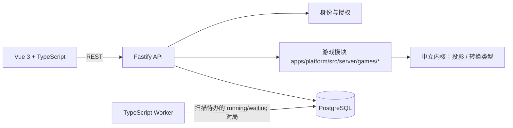

# VBRPG 游戏平台计划与决策日志

> 状态：执行中（greenfield）
> 更新日期：2026-10-15
> 结构：§1–§7 设计与约定、§8 工作分解与现状、§10–§11 门槛与测试、§13 下一步、§16 进度核验与决策日志（按轮次，最新一轮为准）。
> 适用范围：`apps/platform`（TypeScript + PostgreSQL），游戏是代码化模块，平台不解释规则

> 当前执行模式：Greenfield 新项目。旧 Python/Vue 系统、数据迁移、兼容层、双轨切流、旧版本行为兼容和历史黄金轨迹不属于当前交付门槛；旧实现仅作为可选领域参考。后续验收以新 TypeScript 平台、PostgreSQL、中立运行时内核与代码化游戏模块为准（DSL 路线已于 2026-10-15 撤除，见 §16 第六轮）。

## 1. 执行摘要

游戏规则是一台**事件驱动、可持久化、可暂停和恢复的状态机**：玩家输入、计时器、随机事件与 AI 调用都是驱动它继续执行的事件或外部活动。规则本身写在 TypeScript 游戏模块里，平台不解释规则、只负责承载对局。

本计划采用以下结论：

1. 旧 Python/Vue 系统只作领域参考：不逐行翻译，也不做兼容层（见开头的 greenfield 口径）。
2. **游戏逻辑是代码，不是平台解释的 JSON**：一个游戏一个 TypeScript 模块（`apps/platform/src/server/games/<slug>.ts`），平台只提供对局底座与中立内核。原先的声明式 DSL 路线已于 2026-10-15 撤除，见 §16 第六轮。
3. 编排库（LangGraph JS 等）是游戏代码的内部选择，平台不依赖、也不暴露它们（见 §7）。
4. 生产环境只支持 PostgreSQL。内核单测不需要数据库；所有持久化、并发与迁移测试必须运行真实 PostgreSQL。
5. 对局在创建时固定它使用的代码版本；升级游戏代码不影响进行中的对局。
6. 所有权威数据都进入 PostgreSQL：对局状态、席位、事件记录、账号、模型目录、审计。进程内存只允许作缓存。
7. 首版由平台自己维护游戏代码，不提供作者上传代码或包的通道；第三方分发需要单独的沙箱与安全设计。

## 2. 产品目标与非目标

### 2.1 Beta 目标

- 平台账号由管理员创建；用户登录后进入自己的对局列表。
- 平台内置的游戏可以被创建为对局、开始、并跑到结束（游戏代码在 `apps/platform/src/server/games/*` 维护）。
- 玩家可以加入对局，在断线、服务重启后继续。
- 一个对局可以同时包含真人和 AI 席位。
- 玩家只能看到自己有权看到的信息，且这一点由平台强制（投影 fail-closed），不依赖游戏代码自觉。
- 对局数据一律经过投影读取，隐藏信息不因接口扩张而泄漏。
- 每次状态变化可审计、可查询、可幂等处理。

### 2.2 Beta 非目标

- 不同时支持 PostgreSQL 和 MySQL 生产部署。
- 不提供作者上传代码、第三方 npm 包执行或沙箱插件能力。
- 不提供声明式游戏 DSL、草稿/发布生命周期与发布期静态校验（2026-10-15 撤除）。
- 不在首版完成 Steam 式商业市场、创作者分成和复杂支付结算。
- 不保证把进行中的旧 Python 对局无损迁移到新引擎；优先采用排空旧对局的切换方式。

## 3. 基线

旧 Python/FastAPI + Vue 3 系统仍在仓库根目录（`backend/`、`frontend/`），**只作领域参考**：不迁移它的数据、不复刻它的接口、不保留它的运行契约。新平台是 greenfield，`apps/platform` 是唯一在维护的代码（ADR-007）。

当前实现到什么程度、还缺什么，见 §16。

## 4. 目标架构



实际结构（2026-10-15 起）：**一个包、一个镜像、两种角色**。

```text
apps/platform/
  src/shared/          # 契约：Zod schema + 类型（浏览器安全，不许 import node 内建）
  src/server/          # 进程侧：Fastify 路由、鉴权、存储、worker 扫描、游戏内核
    game/              # 中立内核：GameModule 接口、注册表、投影
    db/                # Kysely 类型、仓储、迁移读取
    runtime/           # 凭据加密、错误形状
  src/browser/         # Vue 3 控制台（构建成静态资源，由同一进程提供）
  migrations/          # SQL 迁移
  scripts/             # migrate / bootstrap-admin / db-integration / provider check
```

仓库根的 `backend/`、`frontend/` 是旧系统，不在交付门槛内。

三种角色、同一个镜像：`--role=api`（HTTP + 静态资源）、`--role=worker`（推进对局）、`--role=both`（本地开发）。
浏览器产物由 api 角色同源提供，因此不再需要 nginx、跨域配置或第二个服务。

推荐技术组合：

- Monorepo：pnpm workspace。
- Web：Vue 3 + TypeScript，逐个模块迁移，不一次性重写 UI。
- API：Node.js LTS + Fastify。
- 契约：Zod；REST 与后台任务共用同一份 schema。
- 数据层：PostgreSQL + Kysely；迁移工具必须支持纯 SQL 审核。
- 后台任务：不引入队列中间件与 Redis；worker 扫描 `running`/`waiting` 的对局、按实例加行锁推进（ADR-009）。
- AI：优先使用模型提供商官方 SDK；游戏代码可以在自己的模块内部使用任意编排库（包括 LangGraph JS），平台不依赖它。
- 可观测性：结构化日志、OpenTelemetry trace、错误追踪、业务指标。

### 4.1 游戏模块：代码化封装

游戏是普通 TypeScript 模块，放在 `apps/platform/src/server/games/<slug>.ts`，一个游戏一个模块。平台不解释、也不发布作者上传的定义：

| 关注点 | 由谁负责 |
| --- | --- |
| 阶段、等待点、分支、结束 | 游戏模块的 `transition` |
| 动作合法性、结算、胜负 | 游戏模块自己的规则代码 |
| 不同玩家能看到什么 | 游戏模块声明可见性，内核据此投影 |
| 表现（文案、角色卡、资源） | 前端；游戏模块可自带静态资源 |

平台只保证四件事：

1. **对局有身份**：`game_instances` + `game_participants`（席位是人还是 AI）。
2. **记录可查**：`game_events` 按 `sequence` 存下发生过的一切（ADR-010）。
3. **写入幂等**：`(instance_id, sequence)` 与 `(instance_id, idempotency_key)` 保证重试不重复结算，按实例行锁保证同一对局的写入串行。
4. **信息不越权**：`projectPlayerView` 按游戏声明的可见性投影，fail-closed。

其余都是游戏代码的事。

2026-10-15 变更：原先"作者用 JSON 描述游戏、平台校验并解释执行"的 DSL 路线已撤除，见 §16 第六轮。撤除的代价要写清楚：不再有发布期静态校验，也不再"作者零代码"。

### 4.2 中立内核契约

内核只认接口，不认识任何节点、配置或表达式（实现见 `apps/platform/src/server/game/module.ts`）：

```ts
interface GameModule {
  readonly id: string;
  readonly version: string;
  readonly engineVersion: string;
  readonly visibility?: Record<string, unknown>;   // 哪个变量谁能看；未声明=没人能看
  initialState(input: CreateInstanceInput): GameState;   // 角色、发牌、初始变量由游戏决定
  transition(state: GameState, event: GameEvent): TransitionResult;
}

class GameRegistry { get(id); require(id); list(); }   // 启动时注册，重复 id 直接拒绝
```

`transition` 内不能访问数据库、网络、系统时间或直接调用 LLM。随机数、时间与 AI 结果都必须作为显式输入（事件）进来；它只能返回新的状态与要追加的事件，由平台在事务里落库。

已落地的内核：`GameModule` 接口 + `GameRegistry` + `createBaseState`（对局外壳）+ `projectPlayerView`（三档投影，fail-closed）+ `EngineError`/`TransitionResult`。（`replayEvents` 已于 2026-10-15 第十轮删除：记录是给人读的历史，不是重建状态的输入，见 ADR-010。）

### 4.3 单次动作的事务协议

每次玩家动作采用固定顺序：

1. 从认证会话解析调用者身份，不信任客户端提交的身份字段。
2. 校验席位归属与实例状态；按实例取行锁，串行化同一对局的写入。
3. 读取 `state_json` 与 `current_sequence`。
4. 执行确定性状态转换，直到结束或进入等待点。
5. 在同一事务里追加记录行、推进 `current_sequence` 与 `state_json`。
6. 提交事务。提交之后才做外部动作（调模型、推送）。
7. 读路径没有第二步：按 `sequence` 读记录，或按投影规则读状态。

任何重试都必须依靠 `(instance_id, sequence)` 与 `(instance_id, idempotency_key)` 唯一约束避免重复结算；
`update ... where current_sequence = N-1` 影响零行就说明别人先推进了。

## 5. 游戏封装方式（代码化）

- 游戏逻辑写在 TypeScript 模块里：类型检查、单元测试、调试器、重构工具都是现成的，不需要平台自造一套 schema 语言。
- **不提供**：作者上传代码或包、草稿/测试/发布生命周期、发布期静态校验、声明式节点与白名单表达式。
- **版本固定**：代码里的 `version` 常量 + 对局行记录；对局开始时固定，升级代码不影响进行中的对局。
- **确定性**：由"`transition` 是纯函数"这条约束 + 内核测试保证；违反它属于代码缺陷，不再是发布期能拦住的问题。
- **信息隔离**：由内核投影统一执行；游戏模块只声明"哪个变量谁能看"，不能绕过投影直接下发权威状态。
- **平台内置**：首版游戏由平台自己维护；第三方游戏分发属于后续阶段，需要单独的沙箱与安全设计。

## 6. 数据模型

### 6.1 身份与权限

平台只有两种账号角色，由 `users.platform_role` 决定：

| 角色 | 权限范围 |
| --- | --- |
| `admin` | 管理账号、模型目录与凭据、查看审计、对局运维（暂停/恢复/取消） |
| `user` | 登录、加入对局、按投影读取自己可见的信息 |

对局的参与关系不在角色里，而在 `game_participants`：一张席位要么绑定 `actor_user_id`（真人），要么 `control = 'ai'`。授权判断始终回到这两处，不信任请求里出现的身份字段。

### 6.2 首版核心表

| 表 | 作用 |
| --- | --- |
| `users` | 平台账号与平台角色 |
| `auth_sessions` | 不透明会话（Cookie）、CSRF 摘要、滑动与绝对过期 |
| `providers` / `provider_models` | 模型供应商与模型目录（凭据以 AEAD 密文存列内） |
| `game_instances` | 对局、记录的代码版本、状态、当前序号 |
| `game_participants` | 对局参与者、座位、控制方式 |
| `game_events` | 对局记录：一行一层意思，按 `sequence` 读；含 AI 每次交互与用量（ADR-010） |
| `audit_logs` | 账号、模型目录与对局运维操作审计 |

2026-10-15 撤除 DSL 时删掉了 `games`、`game_versions`、`workflow_definitions`、`ai_usage_ledger` 与 `agent_model_bindings`：游戏身份与版本回到代码里，模型目录留在 `providers`/`provider_models`。`game_instances.game_version_id` 保留为纯文本（对局自报的代码版本），不再有外键。

2026-10-15 第八轮又把租户层整体删掉（ADR-008）：`tenants`、`tenant_memberships`、`tenant_secrets`、`player_actions`、`outbox_events` 五张表与所有 `tenant_id` 列、RLS 策略一并撤除——它们在当时的产品形态下不产生价值（唯一租户是常量 `PLATFORM_TENANT_ID`），却让每个查询、每个唯一键、每张新表都带着恒定成本。删除后剩 11 张表。

2026-10-15 第九轮再删掉三张（ADR-009）：`game_snapshots`（与 `state_json` 重复的历史副本）、`pending_commands` 与 `scheduled_jobs`（唯一消费者是尚未定案的实时推送与延迟副作用），以及它们唯一的生产者契约 `ExternalCommand`。对局只剩三张表：`game_instances`、`game_participants`、`game_events`。合计 8 张表：账号 2、模型目录 2、对局 3、审计 1。

关键唯一约束：

```text
(instance_id, sequence) on game_events        -- 顺序靠序号，不靠时间
(instance_id, idempotency_key) on game_events -- 追加幂等
(instance_id, participant_key) on game_participants
(instance_id, seat) on game_participants
(provider_id, model_id) on provider_models
```

`game_events` 是**对局记录**，不是重建状态的输入：`state_json` 是当前状态的真相，两者在同一事务里一起写，
读历史就是按 `sequence` 读行（ADR-010）。行里有 `type`、`participant_id`、`actor_user_id`、`step_id`、
`payload`，模型调用行另外带 `provider_id`/`model_id`/三个 token 计数（由约束保证要么全空要么全填）。
读历史不做行级过滤：能看这个对局，就能读到全部内容（含各席位的思考）。

状态用 `jsonb` 存（`game_instances.state_json`）；需要筛选、排序、关联和约束的数据使用普通关系列。对局相关的前缀（`instance_id`）都在每个唯一键里，所以跨对局的撞号不可能发生。

排队与超时不再有表：worker 改为"扫描 `running`/`waiting` 的对局、按实例加行锁、看它现在欠什么（玩家输入超时？AI 席位等回复？）"。代价是失败的退避与上限没有持久化位置，需要由游戏规则定义后果（契约里已有 `aiFailed`），这一条列入第九轮的已知取舍。

### 6.3 数据库和二进制资源决策

- PostgreSQL 是生产唯一权威数据库。
- 内核单测不需要数据库；涉及锁、事务隔离、`jsonb`、迁移和 worker 的测试一律使用 PostgreSQL。
- 本地完整开发通过 Docker Compose 启动 PostgreSQL；CI 同样运行 PostgreSQL 服务。
- 若“所有存储都进数据库”是硬要求，Beta 可用 `bytea` 保存小型资源，但必须设置单文件和总量上限。大文件会放大备份、复制和恢复成本，公开发布前应重新评估 S3 兼容对象存储；对象元数据和权限仍归 PostgreSQL 管理。

## 7. 编排库（LangGraph 等）的定位

DSL 撤除后，这个问题变简单了：**编排库是游戏代码的内部实现细节，不是平台组件**。

- 平台不依赖任何编排框架，数据库、API 和契约里不出现它们的类型。
- 游戏模块内部可以用任意方式组织逻辑：一个 `switch`、一个状态机库，或 LangGraph JS。这不影响平台能力，因为平台只通过 `GameModule` 接口与游戏交互。
- 平台的四条保证（对局身份、记录可查、写入幂等、信息不越权）由内核与数据库提供，不由游戏代码自己声明；编排库的 checkpoint 只是它自己的内部状态，永远不能成为业务真相。
- 多玩家等待：每个玩家的动作各写一行记录；达到全员、法定人数或超时条件后只推进一步，不能让每个玩家分别推进一步。

Phase 0 原本用 LangGraph JS 的对照来决定"首版执行器"，随着 DSL 撤除，这个决策点不再成立；对照与书面结论见 §16。

## 8. 工作分解与现状

任务编号（`P{phase}-{seq}`）保留，便于与 §16 的决策日志对照。被决策取代的任务用删除线留下编号，不留正文。人周估算已删除——它建立在"从旧系统迁移"的前提上，这个前提不再成立。

### Phase 0：决策与技术验证（已关闭）

目标：把技术不确定性前置。

- [x] `P0-01`：ADR 确认数据库、运行时边界、schema 工具、数据访问层与资源存储。 — 已完成（`docs/adr/`）。
- [x] ~~`P0-02`：冻结旧系统行为并生成黄金轨迹。~~ — 关闭：旧引擎与夹具已删除，greenfield 下不与旧行为比对。
- [x] ~~`P0-03`：为旧系统测试建立基线分类。~~ — 关闭：以新平台自身的测试门禁为准。
- [x] ~~`P0-04`：定义领域 schema v0。~~ — 已被 §4.2 与 §6 的契约取代。
- [x] ~~`P0-05`：LangGraph JS 技术验证。~~ — 关闭：编排库是游戏代码的内部选择（§7）。
- [x] `P0-06`：定义 Beta 负载模型：100 个活跃对局、每局 10 席、峰值每秒 20 次动作。 — 目标保留（见 §10），容量测试未做。
- [x] ~~`P0-07`：确定旧数据处置。~~ — 关闭：greenfield 不迁移旧数据（§9）。

出口条件：ADR 已评审；负载模型已记录。

### Phase 1：工程基础（已完成）

目标：可构建、可测试、可部署的骨架。

- [x] `P1-01`：建立工程骨架与共享契约。 — 由 ADR-007 收敛为单包 `apps/platform`（shared / server / browser 三个 tsconfig project）。
- [x] `P1-02`：Fastify 骨架：健康检查、统一错误模型、请求 ID、结构化日志、配置校验。
- [x] ~~`P1-03`：把旧前端切到 TypeScript。~~ — 关闭：不迁移旧前端，控制台在 `src/browser` 重写。
- [x] `P1-04`：PostgreSQL Compose、迁移命令、集成测试库与种子脚本。
- [/] `P1-05`：CI 门禁：构建、类型检查、单测、契约、真实 PostgreSQL 集成、迁移回滚、依赖审计。 — **缺 lint 与格式检查**；E2E 未进 CI。
- [x] `P1-06`：统一 Node、pnpm 与容器版本。
- [x] `P1-07`：前后端共用一份契约（Zod schema 推导类型），禁止手写重复 DTO。

出口条件：CI 全绿（lint 除外，见 `P1-05`）。

### Phase 2：身份与持久化底座（已完成）

目标：可信的身份边界与可重试的持久化底座。

- [x] `P2-01`：账号与会话：持久化 session（HttpOnly Cookie）、CSRF、scrypt、首登强制改密、管理员重置撤销旧会话；无公开注册。
- [x] ~~`P2-02`：租户、邀请、成员与 RBAC。~~ — 撤销（第八轮，ADR-008）：只有平台 `admin`/`user` 与 `game_participants` 席位。
- [x] `P2-03`：核心表、索引、唯一约束与外键。
- [x] ~~`P2-04`：tenant-scoped repository。~~ — 撤销（第八轮）：租户上下文参数已移除。
- [x] ~~`P2-05`：启用并测试 RLS。~~ — 撤销（第八轮）：策略与应用过滤引用同一个常量，等于自证。
- [/] `P2-06`：审计、凭据信封加密、密钥轮换与日志脱敏。 — 审计与 AEAD 加密已落地；**密钥轮换流程未实现**。
- [x] ~~`P2-07`：队列的 claim / lease / 重试 / 死信。~~ — 撤销（第九轮，ADR-009）：队列表已删除，工作来源改为实例状态推导。
- [x] ~~`P2-08`：跨租户攻击测试。~~ — 撤销（第八轮）：无租户边界；替身是"非参与者读不到对局"的投影测试。

出口条件：未经认证的请求无法读写任何资源；重复提交不产生重复记录。

### Phase 3：中立内核与对局底座（内核完成，运行时空缺）

目标：让平台能可靠承载**任意代码化游戏**——对局有身份、记录可查、写入幂等、信息不越权。

- [x] ~~`P3-01` / `P3-02` / `P3-04` / `P3-05`：DSL schema、发布期校验、节点集、subflow/parallel。~~ — 撤销（第六轮）：不再有可发布定义。
- [x] `P3-03`：确定性 `transition` 与显式随机种子。 — 由"`transition` 是纯函数"这条约束保证（随机与时间都作为输入进来）。
- [/] `P3-06`：并发控制、动作幂等与实例级顺序号。 — 约束已在（`(instance_id, sequence)`、`(instance_id, idempotency_key)`）；**并发竞争测试未做**。
- [x] `P3-07`：三档投影与防泄漏测试（`projectPlayerView`，fail-closed）。
- [x] ~~`P3-08` / `P3-09`：LangGraph 适配器、AI command 链。~~ — 撤销：编排库与 AI 调度都不属于平台。
- [x] ~~`P3-10`：管理员暂停/取消/强制超时。~~ — 撤销：随实例路由删除；恢复对局的运维能力随对局运行时回归。

本阶段的缺口（下一步就做这些）：

1. **对局 HTTP 入口**：创建对局、提交事件、读投影与完整记录。
2. **写入路径的仓储函数**：`game_participants` 与 `game_events` 目前零引用——席位写入、追加记录、按 `current_sequence` 乐观推进都还没有。
3. **worker 的实例扫描**：找出 `running`/`waiting` 的对局、按实例取行锁、推进它当前欠的事。

出口条件：`transition` 对同一输入总是产出同一状态；进程崩溃不丢失已提交的写入；隐藏信息自动化测试无泄漏。

### Phase 4：第一个代码化游戏（未开始）

目标：用一个真实复杂游戏证明抽象够用——**平台代码里没有一行该游戏的规则**。候选是狼人杀（规格提取 `P4-01` 已完成一部分），具体先做哪个未定。

- [/] `P4-01`：提取角色、阶段、动作、胜负、超时与可见性规格。 — 狼人杀的角色/阶段/动作/胜负已提取；超时与可见性规格未提取。
- [ ] `P4-02`：把游戏写成代码化模块（`apps/platform/src/server/games/<slug>.ts`），不在平台里加该游戏专用分支。
- [x] ~~`P4-03`：prompt、模型参数与输出 schema 随版本保存。~~ — 撤销：AI 行为由游戏代码自己组织；平台提供模型目录与凭据。
- [x] ~~`P4-04`：用黄金轨迹比较新旧实现。~~ — 关闭：旧引擎与其夹具已删除。
- [x] ~~`P4-05` / `P4-06`：旧数据回填与灰度切流。~~ — 撤销：greenfield，没有租户也没有双轨。
- [ ] `P4-07`：断线重连、多设备、并发动作、AI 失败、worker 重启与版本升级的 E2E。

出口条件：整局端到端跑通，无状态丢失、重复结算与秘密泄漏。

### Phase 5：游戏模块的工程化与内部工具（部分完成）

目标：平台团队能高效地写、测、发布游戏模块（不面向外部作者）。

- [ ] `P5-01`：游戏清单（内置游戏与版本）与对局创建入口。 — 与 Phase 3 的 HTTP 入口同一件事，一起做。
- [x] ~~`P5-02`：结构化编辑器与只读流程图。~~ — 撤销：游戏是代码，用 IDE 与类型系统。
- [ ] `P5-03`：测试控制台：注入事件、查看各席位投影、按序查看完整记录。
- [ ] `P5-04`：回归夹具：标准对局脚本 + 期望记录序列 + 隐藏信息断言。
- [ ] `P5-05`：游戏自带静态资源（角色卡、文案）的打包与版本校验。
- [ ] `P5-06`：内部发布流程：代码评审、版本号、变更记录。
- [ ] `P5-07`：游戏模块开发文档与示例模块。
- [x] ~~`P5-08`：可移植游戏包格式。~~ — 撤销：首版由平台自己维护游戏代码。

出口条件：不改平台代码即可新增一个游戏模块，并用回归夹具证明标准对局跑通、信息不漏。

### Phase 6：部署与公开 Beta（未开始）

目标：在可观测、可恢复的条件下把平台交付给真实用户。

- [ ] `P6-01`：容量测试、长时间稳定性、并发动作与故障注入。
- [ ] `P6-02`：指标：API 延迟与错误率、动作延迟、AI 成功率与 token 用量、卡住的对局、未授权访问拒绝。
- [ ] `P6-03`：备份、时间点恢复、迁移回滚、密钥轮换与灾难恢复演练。
- [ ] `P6-04`：安全评审：认证、授权、提示词注入、日志隐私、供应链。
- [ ] `P6-05`：逐级放量。
- [ ] `P6-07`：部署、运维、故障处理与数据保留文档。
- [ ] `P6-09`：条款、隐私说明、数据导出/删除流程的发布评审。

交付物：公开 Beta、监控面板、告警、备份恢复证据与运行手册。

出口条件：满足 §10 全部门槛，并完成一次备份恢复演练与一次应用回滚演练。

回滚：回滚镜像版本；迁移在此之前必须演练过，且不能丢失已写入的记录与审计。

### Phase 7：Beta 后增强

- 更完整的对局调试器与可观测面板。
- 第三方游戏分发：需要单独的沙箱、资源限额与安全评审，属独立阶段。
- 创作者商业化、支付、结算与税务流程。
- 评分、推荐、内容审核与版权申诉。
- 多区域部署、更严格的 SLO；并发对局到数千时把队列按实测需求加回来（ADR-009）。

## 9. 旧数据与切流（不适用）

Greenfield：**不迁移旧数据、不做双轨切流、不引入兼容层**（2026-10-15 决定）。旧系统（`backend/`、`frontend/`）只作领域参考，新平台直接对外提供。

若将来确有必须保留的历史数据，那是一次独立的数据导入任务，不是平台架构的一部分。

## 10. 发布门槛（Definition of Release Ready）

以下条件全部满足才进入公开 Beta：

### 正确性与恢复

- 重复提交与重试不会重复结算（幂等键与顺序号唯一约束承担）。
- 任意服务进程重启后，已提交的写入不丢失；进程重启只影响正在进行的模型调用。
- 任何时刻都能按 `sequence` 读到该对局的完整记录。
- AI 超时、结构化输出错误和供应商不可用不会让实例永久卡住。

### 安全

- REST、后台任务和管理入口都有未认证与非管理员访问的自动化测试。
- 没有由客户端直接决定的可信 `user_id` 或角色。
- 玩家投影与 AI prompt 不泄露无权查看的隐藏状态（投影由内核 fail-closed 执行；prompt 由 harness 按席位组装）。
- 凭据加密存储，日志脱敏，敏感操作有审计记录。
- 发布时没有未处置的 P0/P1 安全缺陷。

### 工程质量

- CI 的 lint、类型检查、单元、PostgreSQL 集成、契约、E2E 和构建全部绿色。
- 迁移在生产数据副本上验证，升级与回滚路径均演练（含 `.down.sql`）。
- 容器、CI 和本地支持的 Node/PostgreSQL 版本一致并有明确生命周期。
- 契约（契约 schema 与事件类型词表）有版本策略；游戏代码的 `gameVersionId` 与对局行绑定。

### 运维与容量

- 达到 Phase 0 确认的负载目标，并保留容量余量；AI 时间不计入同步 API 延迟。
- 对动作处理延迟、错误率、卡住的对局、AI 成功率与 token 用量、数据库连接设有指标及告警。
- 完成一次备份恢复演练，记录 RPO/RTO 实测结果。
- 有部署、回滚、卡局处置、密钥轮换和数据导出/删除手册。

## 11. 测试矩阵

| 层级 | 运行数据库 | 重点 |
| --- | --- | --- |
| 内核单测 | 无数据库 | 投影、转换、确定性 |
| 游戏模块单测 | 无数据库 | 角色、阶段、动作合法性、胜负、隐藏信息 |
| Repository 合约测试 | PostgreSQL | 约束、事务、行锁、迁移与回滚 |
| 对局写入集成测试 | PostgreSQL | 幂等、并发、乐观推进、记录顺序 |
| API 契约测试 | PostgreSQL | 身份、错误模型、幂等与重复提交 |
| 对局端到端测试 | PostgreSQL | 完整对局、隐藏信息、AI 席位 |
| E2E | 完整 Compose | 登录、建 provider/model、创建并跑完一局 |
| 安全测试 | 完整 Compose | IDOR、未授权读写、prompt 注入、权限提升 |
| 容量与故障测试 | 类生产 PostgreSQL | 峰值动作、worker 崩溃、数据库抖动、AI 超时 |

集成测试必须运行真实 PostgreSQL；内存或内存库通过不算过关。

## 12. 风险与缓解措施

| 风险 | 影响 | 缓解 |
| --- | --- | --- |
| 游戏代码绕过平台保证（直接写库、泄漏隐藏状态） | 泄漏、脏状态 | 游戏模块只拿到状态与事件、只能返回状态与事件；投影由内核统一执行（fail-closed）；代码评审与隐藏信息断言 |
| 游戏代码不确定（时间/随机/网络） | 同一事件序列得到不同状态，记录与状态对不上 | `transition` 纯函数约束 + 内核测试；随机种子与时间作为显式事件输入 |
| 隐藏信息泄漏 | 严重作弊和隐私事故 | 权威状态与玩家投影分离；按角色属性测试；日志和 prompt 脱敏 |
| AI 调用拖垮对局或成本 | 卡局、费用不可控 | 平台提供模型目录与凭据；失败后果由游戏规则定义（`aiFailed`）；每次调用的用量随行入库（ADR-010），成本报表待做 |
| 大资源存入 PG | 备份和复制膨胀 | 首版大小/配额限制；公开发布前评估对象存储 |
| 一次性重写前后端 | 交付周期失控 | 按新实例灰度 |

## 13. 下一步的具体安排

按依赖顺序，一步一个可验证的闭环：

1. **对局 HTTP 入口**：创建对局（写 `game_instances` + `game_participants` + 首条记录行）、提交事件（校验幂等键、跑 `transition`、在同一事务里追加记录行并推进 `current_sequence`）、读自己的投影与完整记录（按 `sequence`）。
2. **worker 的实例扫描**：找出 `running`/`waiting` 的对局，按实例取行锁，处理它当前欠的事（玩家输入超时、AI 席位等回复），推进完提交。
3. **第一个代码化游戏**：`apps/platform/src/server/games/<slug>.ts` + 回归夹具（标准对局脚本、期望记录序列、隐藏信息断言）。
4. **AI 席位**：每次模型调用写一行（`aiCall`，带用量、思考与签名字段），回合结果写一行；prompt 由 harness 按席位过滤组装。

## 14. 项目管理约定

- 每项任务进入开发前必须写明输入、输出、测试和数据库影响。
- 每个数据库变更必须可重复执行并带 `.down.sql` 回滚体；greenfield 阶段允许直接重写迁移，不留兼容路径。
- 每个游戏模块必须带回归夹具（标准对局 + 期望记录序列），并证明隐藏信息不漏。
- 每个写入必须能回答三件事：谁触发的、幂等键是什么、失败重试会不会重复。
- 每个阶段结束进行一次出口评审，不以“代码已合并”代替验收结果。
- 工作看板建议使用任务编号 `P{phase}-{sequence}`，缺陷使用 `BUG-{sequence}`，架构决策使用 `ADR-{sequence}`。

## 15. 技术决策与当前状态

| 决策 | 结论 | 依据 | 当前状态 |
| --- | --- | --- | --- |
| 生产数据库 | PostgreSQL only | `P0-01` | 已落地（ADR-001） |
| API 框架 | Fastify | `P0-01` | 已落地（`apps/platform`） |
| Schema 工具 | Zod 或 TypeBox 二选一 | `P0-01` | 已落地：Zod（ADR-003） |
| 数据访问层 | Drizzle 或 Kysely 二选一 | `P0-01` | 已落地：Kysely（ADR-004） |
| 首版运行时 | 无编排运行时 | `P0-05` | 已关闭：编排库是游戏代码的内部选择（§7） |
| 二进制资源 | PG `bytea` + 严格上限；发布前复审对象存储 | ADR-005 | 决策保留；尚无使用点 |
| 身份方案 | 自建账号 + 不透明会话 | `P2-01` 前 | 已落地（`routes/platform-auth.ts`） |
| 旧数据与切流 | 不迁移、不双轨 | 2026-10-15 | 已作废（见 §9） |
| Beta 容量目标 | 默认 100 房间 / 1000 在线 / 20 动作每秒 | `P0-06` | 目标保留；容量测试未做 |

## 16. 核验结论与下一步

核验方式：对照 `apps/platform` 源码、迁移文件、测试与已提交历史逐项判定，不采信文档的自我描述。§8 的任务勾选状态随时间变化，以下结论以最新一轮为准。

### 已完成的主干（截至 2026-10-15）

- 工程骨架：单包 `apps/platform`（shared/server/browser 三个 tsconfig project）、一个镜像两种角色、真实 PostgreSQL 集成与迁移回滚门禁。
- 控制面与认证：管理员建号与重置、首登强制改密、不透明会话 + CSRF、Provider/Model 管理与 AEAD 凭据加密、审计。
- 中立内核：`GameModule` + `GameRegistry` + `createBaseState` + `projectPlayerView`（fail-closed）+ `EngineError`/`TransitionResult`。
- 数据底座：8 张表——账号 2、模型目录 2、对局 3（`game_instances`/`game_participants`/`game_events`）、审计 1。

### 关键断点（比任务勾选更重要）

1. **没有对局运行时**：创建/推进对局的 HTTP 入口还不存在，`GameRegistry` 没有消费者（运行时注册表是空的，`games/` 目录也还没建），平台目前只能做账号与模型目录管理。
2. **worker 无事可做**：实例扫描随对局运行时落地，当前循环只打日志。
3. **`game_participants` 与 `game_events` 零代码引用**：连仓储函数都还没有（追加事件、乐观推进、席位写入）。
4. **AI 能力只剩目录与凭据**：没有调用链，没有用量记录；席位实现时要落 `aiCall` 行。
5. **前端只有账号与模型配置页面**：`src/browser` 的 Login/ChangePassword/Lobby/Users/Providers，没有对局界面。

### 历史复核记录

- **第一轮（2026-10-14）**：逐项核验 §8 任务并标注证据。
- **第二轮（2026-10-14）**：复核全部进度文档与实现的不一致项——黄金轨迹门禁断链（`werewolf_engine.py` 已删除）、旧后端基线过期（`backend/.venv` 571 测试全绿）、测试数与报告过期、AI 实网验收不可复现（TokenHub+`hy3` 现返 401，可用组合为 `api.deepseek.com`+`deepseek-chat`）、契约未覆盖并存端点、一键启动缺 worker 服务。
- **第三轮（2026-10-15，已随第六轮撤除）**：显式循环节点（`loop`）与发布期环规则；狼人杀包升级为多回合；修复 worker 领取查询的时钟来源缺陷（`pending_commands.available_at` 改为与数据库时钟比较，该修复保留）。
- **第四轮（2026-10-15，已随第六轮撤除）**：AI prompt 改为按席位投影（不再序列化权威状态与事件 payload）。其中"prompt 不得泄漏"这条原则仍然成立，代码化游戏沿用同一套投影。
- **第五轮（2026-10-15，已随第六轮撤除）**：agent 定义随版本保存（`agents[]`）、每席位一个 agent 的会话模型。

### 第六轮（2026-10-15）：撤除 DSL，改为代码化游戏封装

**决策**：放弃"作者用 JSON 描述游戏、平台校验并解释执行"的路线。游戏逻辑改为 TypeScript 模块（`apps/platform/src/server/games/<slug>.ts`），平台只保留对局底座与中立内核。理由：DSL 的维护面（schema、校验器、表达式、解释器、发布流程）远大于它带来的收益，而代码化游戏直接获得类型检查、单元测试与调试器。

**删除**（提交 `refactor: drop the declarative game DSL, keep the neutral kernel`，60 个文件、-6881 行）：

- `packages/workflow-engine`：编译、发布期校验、表达式 AST、节点解释器、狼人杀夹具（内核的投影/重放/类型保留）。
- 契约：游戏定义、节点、agent 定义、实例/事件请求 schema（状态、事件、参与者、等待点、命令、玩家视图保留）。
- `packages/runtime`：AI 命令链、实例执行、管理员控制（凭据加密与错误类型保留）。
- `apps/api`：实例、管理员实例、MVP 无状态路由与其脚本、AI provider 配置项。
- `apps/worker`：游戏 handler 接线（claim/lease 循环保留）。
- 迁移：`games`、`game_versions`、`workflow_definitions`、`ai_usage_ledger`、`agent_model_bindings` 五张表；`game_instances.game_version_id` 降为纯文本。
- ADR-002（执行器边界）与 ADR-006（agent 会话）随之下线。

**保留**：租户、账号、会话、Provider/Model 与凭据加密、审计、对局底座与队列、投影与重放内核、前端账号与模型页面、CI 门禁。

**代价（明确记录）**：不再有发布期静态校验；不再"作者零代码"；游戏代码必须自己遵守"`transition` 是纯函数"这条约束；隐藏信息只能通过内核投影保证，游戏代码不得绕过。

### 第七轮（2026-10-15）：收敛为单包单镜像（ADR-007）

**决策**：`packages/{contracts,db,runtime,workflow-engine}` + `apps/{api,worker,web}` 合并为一个 `apps/platform`：

- `src/shared`（契约）、`src/server`（进程侧 + 游戏内核）、`src/browser`（控制台）三个 tsconfig project；
- 一个镜像两种角色：`--role=api|worker|both`，api 角色同源提供浏览器产物（不再需要 nginx、第二个镜像与跨域配置）；
- 内核从包变成 `src/server/game/`，`workflow-engine` 这个名字与它的 DSL 词汇一起消失（`currentNodeId`/`waiting.nodeId` 改为 `stepId`）；
- 契约的 `aiGenerate` 外部命令一并删除（平台当下只能执行 `schedule` 与 `emit`，AI 命令随 AI 工作回归）。

**新增能力**：`GameModule` 接口 + `GameRegistry` + `createBaseState`（§4.2），内核首次有明确的消费者契约。

**代价**：失去包边界强制的无环依赖图，改由 tsconfig project 与评审保证；真要拆包时是机械操作（ADR-007 记录了升级路径）。

**下一步建议顺序**：

1. **对局 HTTP 入口**：创建对局、提交事件、读取自己的投影，复用已保留的对局底座与幂等约束（`GameRegistry` 已就位）。
2. **第一个代码化游戏（狼人杀）**：`apps/platform/src/server/games/werewolf.ts` + 回归夹具（标准对局脚本 + 期望事件序列 + 隐藏信息断言）。
3. **AI 席位与 mailbox**：游戏代码内部调用模型，平台提供模型目录与凭据解析；消息/会话设计见 §16 第六轮的 mailbox 讨论记录。
4. **工程门禁**：CI 增加 lint 与格式检查（`P1-05` 未收口，边界现在依赖 lint）；密钥轮换流程（`P2-06`）；处置 `pnpm audit` 的 15 high。

### 第八轮（2026-10-15）：删掉租户层与未决的投递层（ADR-008）

**决策**：整体删除租户层与三张不产生价值的表，schema 从 16 张收敛到 11 张，并把 schema 直接改到位（greenfield、库中无数据，不留 expand/contract 兼容路径）。

**删除**：

- 表：`tenants`、`tenant_memberships`、`tenant_secrets`、`player_actions`、`outbox_events`。
- 列与约束：所有表的 `tenant_id`、复合外键与复合唯一键、`providers.name` 的租户内唯一；`auth_sessions.refresh_token_hash`（零使用的遗留列）。
- RLS：原 `0004_tenant_rls.sql` 及其 12 张表的策略。
- 代码：`withTenantContext`、`platformContext`、`PLATFORM_TENANT_ID`、租户作用域仓储、`recordPlayerAction`、Outbox 的 claim/complete、worker 的按租户循环。
- 遗留 bearer 认证路径：`server/auth.ts`（JWT 风格 token + 租户角色）、`routes/auth.ts`（`/v1/tenant/me`、`/v1/tenant/management-check`）、`AUTH_TOKEN_SECRET`、`x-tenant-id`、`app.ts` 的鉴权 hook 与 `main.ts` 的 `sessionLookup`。平台会话（不透明 session + HttpOnly Cookie + CSRF）成为唯一认证路径。
- 迁移文件：原 0001/0003/0004/0005 合并重写为 `0001_accounts_and_models`（账号、会话、模型目录、审计）与 `0002_game_runtime`（6 张对局表），两者各带 `.down.sql`。

**理由**：支撑租户层的三条理由里两条已失效——旧数据切流随 greenfield 撤销（`P0-07`、`P4-05`、`P4-06`），`tenant_memberships.developer`（游戏作者/发布）随 DSL 撤除（§16 第六轮）消失；剩下的一条（多客户 SaaS 隔离）是商业决定而非技术必然，且当时唯一租户是常量，RLS 与应用过滤引用同一个值，等于自证。`outbox_events` 的消费者是实时推送，而推送被 `docs/mvp-scope.md` 明确推迟，空表不是设计。

**代价**：迁移文件重写使已有本地/容器数据库必须重建（无兼容路径）；若将来真的需要多社群或 SaaS 隔离，要重新引入这一层（有数据后成本会显著上升）。这一条作为已知风险记录在此。

**保留**：账号与平台角色、不透明会话与 CSRF、模型目录与凭据 AEAD 加密、审计、6 张对局表与两条队列、投影与重放内核、前端账号与模型页面、CI 门禁。

### 第九轮（2026-10-15）：对局只剩三张表（ADR-009）

**决策**：删除 `game_snapshots`、`pending_commands`、`scheduled_jobs`，以及唯一会给后两张表生产数据的契约 `ExternalCommand`（`transition` 的输出只剩 `events`）。对局侧只留 `game_instances`、`game_participants`、`game_events`；全库 8 张表。

**理由**：快照与 `instances.state_json` 是同一份状态的两次存储；队列表提供的是"刚好执行一次、可以晚点、失败能重试"，而它当前既没有生产者也没有消费者，实时推送本身还被 `docs/mvp-scope.md` 推迟。没有队列之后，外部命令通道没有目的地，留着就是死代码。

**连带改动**：

- worker 不再领取队列，改为"扫描 `running`/`waiting` 的对局 → 按实例取行锁 → 看它现在欠什么"。扫描本身随对局运行时一起落地，当前循环无事可做。
- 排序只由 `sequence` 决定（`occurred_at` 只用于展示与超时判断）；`unique (instance_id, sequence)` 是并发写入的兜底。
- 时间只通过等待点表达：`waiting.deadlineMs` 加上一步事件的时间就是截止时刻，平台据此产生 `timerExpired`。

**本轮确认的存储要求**（留给 AI 席位实现时执行）：

- **prompt 不入库**（它可由事件日志重算）。
- **每次模型交互必须入库**，一次调用一行。
- **token 用量必须入库**（至少输入/输出/合计），与那次交互同一行。
- 模型回复原文与 provider 返回的签名字段一并存进该行 payload（带 tools 的请求要求原样回传）。

**已知取舍**（接受并记录）：模型调用的退避与上限没有持久化位置，失败后果由游戏规则定义（契约里已有 `aiFailed`）；需要"任意延迟事件"的游戏不能再表达，只能用等待点加时限；对局规模到数千并发时需要重新引入队列。

### 第十轮（2026-10-15）：`game_events` 定型为对局记录（ADR-010）

**决策**：把"重放"的两种含义分开——本项目要的是"让用户看到整局完整历史"，不是"用事件重算状态"。因此
`state_json` 是当前状态的真相（写路径），`game_events` 是记录（读路径），两者同事务写入。

**行形状**：`sequence`（对局内唯一总序）、`type`、`participant_id`、`actor_user_id`、`step_id`、
`idempotency_key`、`occurred_at`、`payload`，加模型调用行的 `provider_id`/`model_id`/三个 token 计数。
不设 `kind` 判别列（没有重放要保护），不设受众列（能看对局就能看全部）。

**其它确认**：`replayEvents` 与 `TransitionFn` 删除（`transition` 的签名留在 `GameModule` 接口上）；一次模型调用一行、回合结果另写一行；用量由 `num_nonnulls(...) in (0,5)` 保证要么全空要么全填；
`participant_id` 用复合外键绑到同一对局的席位；`game_participants` 因此补 `unique (instance_id, id)`；
按序读由唯一键承担，不再另建索引。

**`replayEvents` 的处置**：**删除**。它唯一的用途是用记录重建状态并与 `state_json` 对账；既然记录不是重建状态的输入，
这条路径就不该存在——留着它会让"日志可以重算出状态"变成一种无人维护的承诺。

## 17. 参考资料

- [PostgreSQL JSON Types](https://www.postgresql.org/docs/current/datatype-json.html)
- [PostgreSQL Explicit Locking](https://www.postgresql.org/docs/current/explicit-locking.html)
- [Zod](https://zod.dev/)、[Kysely](https://kysely.dev/)
