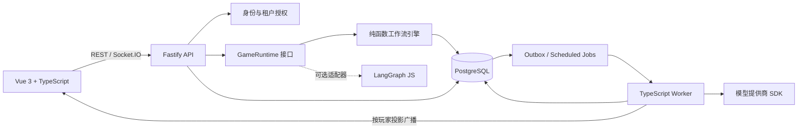

# VBRPG 多租户工作流游戏平台迁移与发布计划

> 状态：提案 / 可执行基线
> 更新日期：2026-08-24
> 状态核验：2026-10-14 逐项对照代码、测试与提交核验 §8/§13 任务状态；结论与下一步见 §16。
> 适用范围：将当前 Python + Vue 项目迁移为以 TypeScript 为主、由用户定义游戏工作流的多租户游戏分发平台

> 当前执行模式：Greenfield 新项目。旧 Python/Vue 系统、数据迁移、兼容层、双轨切流、旧版本行为兼容和历史黄金轨迹不属于当前交付门槛；旧实现仅作为可选领域参考。后续验收以新 TypeScript 平台、PostgreSQL、DSL v1 和新运行时为准。

## 1. 执行摘要

本项目可以把“游戏规则”建模为工作流，但不能只把它当成普通 DAG。更准确的模型是：**事件驱动、可持久化、可暂停和恢复的状态机工作流**。玩家输入、计时器、随机事件和 AI 调用都是驱动工作流继续执行的事件或外部活动。

本计划采用以下结论：

1. 后端迁移到 TypeScript 是合理的，但应按领域边界重构，不能逐行翻译现有 Python 服务。
2. 用户面对的是平台自有、版本化的游戏 DSL，不能直接依赖或暴露 LangGraph API。
3. LangGraph JS 只作为可替换的运行时适配器候选。先完成技术验证，再决定普通游戏流程由 LangGraph JS 执行，还是由轻量自研解释器执行。
4. 生产环境只支持 PostgreSQL，避免第一版同时承担 MySQL、PostgreSQL、SQLite 三套语义差异。SQLite 只运行纯引擎单元测试和轻量本地演示；所有集成测试与 CI 必须运行真实 PostgreSQL。
5. 游戏定义发布后不可修改。运行中的游戏实例固定引用一个 `game_version_id`，新版本不能改变旧对局。
6. 所有权威状态都进入 PostgreSQL：事件、快照、待处理输入、定时任务、AI 命令、审计和用量。进程内存只允许作缓存，不能作为权威存储。
7. 第一版只允许声明式 DSL，不允许作者上传任意 TypeScript、执行 `eval` 或安装 npm 包。沙箱插件属于发布后的独立阶段。

达到可邀请外部作者和玩家参与的 Beta，预计需要 **19～27 人周**；2 名全职工程师并行时约 **10～14 个日历周**，单人串行约 **5～7 个月**。该估算不含高级可视化编辑器、商业结算、移动客户端和任意代码插件沙箱。

## 2. 产品目标与非目标

### 2.1 Beta 目标

- 一个用户可以创建或加入租户，并拥有明确的租户角色。
- 游戏作者可以在租户内创建游戏、编辑草稿、测试、发布不可变版本。
- 作者可以导入、导出和 fork 游戏包，并为游戏声明许可证与署名信息，避免被平台运行时锁定。
- 作者可以使用声明式节点、规则表达式、私密信息投影和 UI 元数据描述一个游戏。
- 玩家可以从目录安装或加入游戏，在断线、服务重启后继续对局。
- 一个对局可以同时包含真人和 AI 角色；AI 超时或失败时，工作流能走到明确的降级路径。
- 所有 REST、WebSocket、后台任务和管理操作都强制租户隔离。
- 每次状态变化可审计、可重放、可幂等处理。

### 2.2 Beta 非目标

- 不同时支持 PostgreSQL 和 MySQL 生产部署。
- 不提供任意代码或第三方 npm 包执行能力。
- 不在首版完成 Steam 式商业市场、创作者分成和复杂支付结算。
- 不要求首版有完整的拖拽式低代码编辑器；结构化表单、JSON 编辑、校验结果和只读流程图足以发布 Beta。
- 不保证把进行中的旧 Python 对局无损迁移到新引擎；优先采用排空旧对局的切换方式。

## 3. 当前基线与主要问题

当前项目已经具备可复用的产品原型，包括 Vue 3 UI、Socket.IO 实时通信、房间流程、AI 玩家接入和一批测试。但它还不是多租户工作流平台：

- 当前后端是 Python/FastAPI/SQLAlchemy，并使用 LangChain；仓库中没有实际使用 LangGraph。
- 核心游戏行为集中在大型服务和 WebSocket 处理器中，迁移难点来自领域逻辑耦合，而不是 Python 语言本身。
- 对局服务和状态存在进程内映射，无法保证多实例部署、重启恢复和后台任务可靠性。
- 数据模型没有完整的 `tenant_id`、成员关系、租户角色和租户级唯一约束。
- 客户端可提交玩家标识；身份与租户上下文还没有成为服务端可信边界。
- 前端主要是 JavaScript/Vue SFC，尚未形成前后端共享 TypeScript 契约。
- 既有测试和工程工具存在基线债务：部分前端测试失败、ESLint 配置与版本不匹配、后端静态检查遗留较多、容器 Node 版本与当前 Vite 要求不一致，且缺少完整 CI 门禁。
- 现有文档对单人、多人、房间和游戏类型的描述有漂移，需要以新的领域术语统一。

这些问题决定了迁移必须先建立行为基线、持久化协议和租户安全边界，然后再迁移具体游戏。

## 4. 目标架构



建议迁移后的仓库结构：

```text
apps/
  web/                 # Vue 3 + TypeScript
  api/                 # Fastify REST / Socket.IO
  worker/              # AI、计时器、Outbox 消费者
packages/
  contracts/           # API、事件、WebSocket 的 Zod/TypeBox 契约
  workflow-schema/     # DSL schema、版本迁移、发布校验
  workflow-engine/     # 无数据库、无网络的确定性状态转换
  game-sdk/            # 游戏包作者工具和测试夹具
  db/                  # PostgreSQL schema、迁移和仓储实现
legacy/
  python-backend/      # 切换期保留；也可暂时保持当前 backend/ 位置
```

推荐技术组合：

- Monorepo：pnpm workspace。
- Web：Vue 3 + TypeScript，逐个模块迁移，不一次性重写 UI。
- API：Node.js LTS + Fastify；Socket.IO 可以先保留，降低客户端迁移成本。
- 契约：Zod 或 TypeBox 选其一，REST、WebSocket、DSL 共用同一份 schema。
- 数据层：PostgreSQL + Drizzle 或 Kysely 选其一；迁移工具必须支持纯 SQL 审核。
- 后台任务：先使用 PostgreSQL 表、行锁和 `SKIP LOCKED` 实现，不把 Redis 设为首版硬依赖。
- AI：优先使用模型提供商官方 SDK；复杂 AI 子流程可接 LangGraph JS。
- 可观测性：结构化日志、OpenTelemetry trace、错误追踪、业务指标。

### 4.1 游戏包的四层模型

每个可发布游戏包包含 manifest 和以下四部分，不能只有节点连线。Manifest 记录稳定游戏标识、版本、作者、许可证、兼容的 DSL/引擎版本、依赖和内容摘要。

| 层 | 负责内容 | 示例 |
| --- | --- | --- |
| Workflow | 阶段、等待点、分支、并行与结束 | 天黑 → 狼人行动 → 预言家行动 → 天亮 |
| Rules | 动作是否合法、如何结算、胜负判断 | 不能投已出局玩家；票数相同时重新投票 |
| Visibility | 不同玩家能看到的状态投影 | 狼人互相可见；预言家查验结果私密 |
| Presentation | 表单、文本、资源、布局提示 | 投票选择器、阶段说明、角色卡 |

工作流解决“下一步去哪里”，规则函数解决“能不能做、怎样改变状态”，可见性层解决“这个玩家能看到什么”。

### 4.2 核心运行时契约

平台对上层暴露稳定接口，具体执行器可以替换：

```ts
interface GameRuntime {
  compile(definition: GameDefinition): Promise<CompiledGame>;
  createInstance(input: CreateInstanceInput): Promise<GameInstance>;
  dispatch(input: DispatchInput): Promise<DispatchResult>;
  getView(input: GetViewInput): Promise<PlayerView>;
}
```

纯引擎的核心必须保持确定性：

```ts
function transition(
  definition: CompiledGame,
  state: GameState,
  input: GameEvent,
): {
  state: GameState;
  events: DomainEvent[];
  commands: ExternalCommand[];
};
```

`transition` 内不能访问数据库、网络、系统时间或直接调用 LLM。随机数、当前时间和 AI 结果都必须作为显式输入；产生副作用时只输出命令，由 worker 在事务提交后执行。

### 4.3 单次动作的事务协议

每次玩家动作采用固定顺序：

1. 从认证信息解析 `actor_id` 和 `tenant_id`，不信任客户端提交的身份字段。
2. 锁定目标 `game_instance`，校验租户、成员资格、实例状态和动作幂等键。
3. 读取实例固定引用的游戏版本和当前快照。
4. 执行确定性状态转换，直到结束或进入等待点。
5. 追加领域事件，更新快照，写入待执行命令、定时任务和 Outbox。
6. 提交同一个数据库事务。
7. worker 消费 Outbox，按不同玩家生成状态投影并广播。

任何重试都必须依靠 `(instance_id, event_id)` 或 `(instance_id, command_id)` 唯一约束避免重复结算。

## 5. 工作流 DSL 范围

### 5.1 第一版节点

第一批实现足以覆盖狼人杀类回合游戏：

- `start`、`end`
- `setVariable`
- `branch`
- `waitForPlayerInput`
- `collectInput`
- `timer`
- `vote`
- `random`
- `aiGenerate`
- `emitEvent`
- `subflow`
- `parallel`、`join`

第一版表达式只允许白名单运算：比较、布尔逻辑、集合查询、计数、有限聚合和平台提供的规则函数。禁止动态导入、文件访问、网络访问、反射和无限循环。

### 5.2 发布生命周期

```text
Draft -> Testing -> Published
                     |
                     +-> 新修改必须创建新的 Draft 版本
```

- Draft 可以反复编辑，不允许创建公开正式对局。
- Testing 可以创建带调试信息的测试对局。
- Published 不可变；撤回只影响新对局，不能改变已有实例。
- 运行实例始终固定 `game_version_id` 和 `engine_version`。

### 5.3 发布前静态校验

编译器至少拒绝以下定义：

- 没有唯一入口、节点不可达或没有任何可达终点。
- 非显式循环、无退出条件循环，或可能无限自动执行的节点链。
- 引用不存在的角色、变量、资源、子流程或节点。
- 玩家输入不符合声明的 schema。
- `parallel` 没有明确的 `join`、法定人数或超时策略。
- 私密字段可能进入公共事件、日志、错误信息或其他玩家投影。
- AI 节点没有超时、重试上限、预算上限和降级分支。
- 等待节点不能取消，也没有超时或管理员处置方式。

## 6. 多租户与数据模型

### 6.1 身份与权限

推荐的租户角色：

| 角色 | 权限范围 |
| --- | --- |
| Owner | 租户设置、成员、密钥、删除和计费 |
| Admin | 成员管理、游戏管理、审计查看 |
| Developer | 创建、编辑、测试和发布游戏版本 |
| Player | 安装、加入和游玩获授权游戏 |

平台管理员与租户角色必须分开。REST、Socket.IO 握手、事件处理、worker 命令和管理脚本都必须携带并验证租户上下文。

### 6.2 首版核心表

| 表 | 作用 |
| --- | --- |
| `tenants` | 租户和状态 |
| `users` | 平台身份 |
| `tenant_memberships` | 用户、租户和角色关系 |
| `games` | 游戏稳定身份、所有者、目录元数据 |
| `game_versions` | 不可变发布版本和状态 |
| `workflow_definitions` | DSL JSON、schema 版本、编译产物摘要 |
| `game_instances` | 对局、固定版本、状态、当前序号 |
| `game_participants` | 对局参与者、座位、控制方式 |
| `game_events` | 只追加的领域事件 |
| `game_snapshots` | 加速恢复的状态快照 |
| `player_actions` | 玩家输入、幂等键、处理结果 |
| `pending_commands` | AI 等外部副作用命令 |
| `scheduled_jobs` | 超时、回合计时器、重试时间 |
| `outbox_events` | 事务后可靠广播与异步通知 |
| `tenant_secrets` | 加密后的租户模型密钥和配置 |
| `ai_usage_ledger` | 模型、token、费用、归属和预算 |
| `audit_logs` | 管理、发布、授权和敏感操作审计 |

所有租户资源表都应包含 `tenant_id`，或通过不可绕过的父表关系证明租户归属；`users` 等平台级身份表除外。关键唯一约束至少包括：

```text
(tenant_id, game_slug)
(tenant_id, game_code)
(instance_id, event_sequence)
(instance_id, event_id)
(instance_id, command_id)
(tenant_id, user_id) on tenant_memberships
```

工作流定义和快照使用 `jsonb`；需要筛选、排序、关联和约束的数据使用普通关系列。应用层查询强制租户条件，PostgreSQL Row-Level Security 作为纵深防御，不能代替应用授权。

### 6.3 数据库和二进制资源决策

- PostgreSQL 是生产唯一权威数据库。
- SQLite 只用于 `workflow-engine` 的纯单元测试；涉及锁、事务隔离、`jsonb`、RLS、迁移和 worker 的测试一律使用 PostgreSQL。
- 本地完整开发通过 Docker Compose 启动 PostgreSQL；CI 同样运行 PostgreSQL 服务。
- 若“所有存储都进数据库”是硬要求，Beta 可用 `bytea` 保存小型资源，但必须设置单文件和租户总量上限。大文件会放大备份、复制和恢复成本，公开发布前应重新评估 S3 兼容对象存储；对象元数据和权限仍归 PostgreSQL 管理。

## 7. LangGraph 的明确定位与决策门槛

LangGraph 的 State、Node、Edge、条件分支、Interrupt、Checkpoint、Thread、Streaming 和 Subgraph 与游戏流程高度重合，LangGraph JS 也允许 TypeScript 后端继续使用这套能力。因此迁移到 TypeScript 不等于必须放弃 LangGraph。

但 LangGraph 是 Agent 编排运行时，不负责以下平台能力：

- 租户、用户、成员和资源授权。
- 游戏包、草稿、发布、安装、搜索和版本兼容。
- 玩家私密视图和防作弊投影。
- 动作幂等、房间并发、计费、审计和运营管理。
- 面向非开发者的稳定 DSL 和发布校验。

因此采用如下边界：

- 平台数据库、API 和 DSL 不出现 LangGraph 专有类型。
- `GameRuntime` 可以有 `LangGraphRuntime` 和 `NativeRuntime` 两种实现。
- LangGraph checkpoint 只是执行器内部状态，业务权威记录仍是平台事件和快照。
- LangGraph interrupt 恢复时节点可能从头执行；interrupt 前的副作用必须通过幂等命令和 Outbox 处理，不能直接扣费或广播。
- 多玩家等待先把动作写入 `player_actions`，达到全员、法定人数或超时条件后只恢复一次流程，不能让每个玩家分别恢复同一图。

Phase 0 技术验证必须实现“分配角色 → 狼人行动 → 预言家行动 → 收集全员投票”，并验证：

1. PostgreSQL 恢复后可以从等待点继续。
2. 并发提交只推进一次状态。
3. 同一动作重试不重复结算。
4. 不同玩家只得到各自可见视图。
5. 旧版本对局不受新版本影响。
6. AI 超时可以进入降级分支。
7. 事件可完整重放为同一快照。

若 LangGraph JS 能自然满足上述条件，则保留为第一版适配器，复杂 AI 子流程优先使用它。若为满足幂等、多人等待、版本固定或回放需要大量绕过其 checkpoint/interrupt 模型，则只替换适配器，改用轻量原生解释器；上层 DSL 和数据模型不变。

## 8. 分阶段迁移计划

以下工期使用“人周”，实际日历时间取决于团队并行度。每个阶段只有满足出口条件后才能进入下一阶段的切流部分；非阻塞工作可以并行。

### Phase 0：决策、行为冻结与技术验证（2～3 人周）

目标：把关键不确定性前置，不在迁移中途重新设计运行时。

任务：

- [x] `P0-01`：编写 ADR，确认 PostgreSQL、Fastify、schema 工具、查询构建器和 Node LTS 版本。 — 核验 2026-10-14：`docs/adr/` 5 份 ADR 已提交
- [/] `P0-02`：冻结旧 Python 对外行为；为创建房间、加入、开始、角色分配、夜间行动、投票、胜负和断线恢复生成黄金事件轨迹。 — 核验 2026-10-14：旧引擎规则轨迹 10 条已冻结并通过校验（`docs/fixtures/werewolf-golden-trace-suite.json`）；超时/断线/AI fallback 需从服务层补录，未做
- [x] `P0-03`：给现有测试分类为“有效回归、过时规格、真实缺陷”，先建立可解释的测试基线。 — 核验 2026-10-14：`docs/phase0-test-baseline.md` 已完成前端分类；后端基线因缺 Python 测试环境未补录
- [x] `P0-04`：定义 `GameDefinition`、`GameEvent`、`GameState`、`PlayerView` 和 `ExternalCommand` v0 schema。 — 核验 2026-10-14：`packages/contracts/src/domain.ts` 已定义 GameDefinition/GameEvent/GameState/PlayerView/ExternalCommand v0
- [/] `P0-05`：完成上一节的 LangGraph JS 技术验证，并以相同测试夹具实现最小原生解释器对照。 — 核验 2026-10-14：NativeRuntime 已完成（`packages/workflow-engine` 15 用例）；LangGraph JS 无依赖、无对照结论
- [x] `P0-06`：定义 Beta 负载模型。默认起点为 100 个活跃房间、每房 10 人、峰值每秒 20 次动作；产品数据出现后再调整。 — 核验 2026-10-14：`docs/phase0-load-and-legacy-decision.md` 已记录容量模型与旧数据处置假设
- [/] `P0-07`：确定旧数据处置：创建默认 `legacy` 租户，保留历史对局，进行中房间切换时排空。 — 核验 2026-10-14：`legacy` 租户处置已决策；回填脚本属 Phase 4，未实现

交付物：ADR、领域 schema v0、黄金轨迹、技术验证报告、测试债务清单、负载与数据迁移决策。

出口条件：

- 团队能够明确回答第一版使用 `LangGraphRuntime` 还是 `NativeRuntime`。
- 至少一条完整简化对局在进程重启、动作重试和并发提交场景中通过。
- 旧系统关键路径已有机器可读的黄金轨迹，后续迁移可以比较行为。

回滚：此阶段不改生产路径，删除实验代码即可。

### Phase 1：TypeScript 工程基础（2～3 人周）

目标：建立可以持续交付的新骨架，不影响旧系统继续运行。

任务：

- [x] `P1-01`：建立 pnpm workspace 和 `apps/api`、`apps/worker`、`packages/contracts`、`packages/db`。 — 核验 2026-10-14：workspace 含 `apps/api`、`apps/web`、`apps/worker`、`packages/contracts`、`packages/db`、`packages/workflow-engine`
- [x] `P1-02`：创建 Fastify 健康检查、统一错误模型、请求 ID、结构化日志和配置校验。 — 核验 2026-10-14：`app.ts` 提供 request id、结构化日志入口、统一错误响应、`/health`、`/ready`；`config.ts` 用 Zod 校验配置
- [/] `P1-03`：把前端构建逐步切到 TypeScript；先迁移 API、Socket.IO、Pinia store 边界，再迁移组件。 — 核验 2026-10-14：`apps/web` 已全 TypeScript（Vue 3 + Vite + vue-tsc 通过）；旧 `frontend/` 的 Pinia store 与 Socket.IO 仍是 JS，按 greenfield 决策不迁
- [x] `P1-04`：建立 PostgreSQL Compose、迁移命令、测试数据库隔离和种子数据。 — 核验 2026-10-14：`docker-compose.platform.yml` Compose + 迁移 up/down + 独立集成库 `vbrpg_db_integration_clean` + `bootstrap-admin` 种子脚本
- [/] `P1-05`：配置格式化、lint、单元测试、集成测试、构建和依赖审计 CI。 — 核验 2026-10-14：`platform-ci.yml` 已含 build/typecheck/unit/契约/真实 PG 集成/迁移回滚/`pnpm audit`；缺 lint、格式检查与 E2E
- [x] `P1-06`：统一 Node 开发版、CI 版和容器版，消除 Vite 与 Node 版本冲突。 — 核验 2026-10-14：`.nvmrc` 24、CI `node-version-file`、pnpm 11.22.0、Docker `node:24-alpine` 已一致
- [x] `P1-07`：从共享 schema 生成或推导前后端类型，禁止手写重复 DTO。 — 核验 2026-10-14：契约由 Zod 定义并导出 `z.infer` 类型，前后端共用 `@vbrpg/contracts`

交付物：可独立部署的新 API/worker 空壳、共享契约、PostgreSQL 开发环境和绿色 CI。

出口条件：全新检出可用一条命令启动 Web、API、worker 和 PostgreSQL；CI 中 lint、类型检查、单测、PG 集成测试和构建全部通过。

回滚：新服务保持无业务流量，旧 Python 服务不变。

### Phase 2：身份、多租户与持久化底座（3～4 人周）

目标：先让所有后续业务运行在可信租户边界内。

任务：

- [x] `P2-01`：实现用户认证、会话或令牌刷新、密码/第三方身份策略。 — 核验 2026-10-14：平台账号 + 持久化 session（HttpOnly Cookie、CSRF、scrypt、首登强制改密、管理员重置撤销旧 session）；无公开注册
- [/] `P2-02`：实现租户、邀请、成员和 Owner/Admin/Developer/Player RBAC。 — 核验 2026-10-14：`tenants`/`tenant_memberships` 与 Owner/Admin/Developer/Player 角色守卫已实现；邀请流程未实现，产品层只暴露 admin/user
- [x] `P2-03`：创建核心表、租户级索引、唯一约束、外键和软删除/归档策略。 — 核验 2026-10-14：0001/0002/0003/0005 覆盖控制面与运行时表、`(tenant_id, id)` 复合外键与租户级唯一约束；软删除用 status 字段
- [/] `P2-04`：建立 tenant-scoped repository；代码评审禁止无租户上下文的业务查询。 — 核验 2026-10-14：`withTenantContext` + `SET LOCAL app.tenant_id` 与租户作用域仓储已实现；无禁止无租户查询的静态门禁
- [x] `P2-05`：为关键表启用并测试 PostgreSQL RLS。 — 核验 2026-10-14：0004 RLS 已启用，非 owner 角色跨租户隔离在真实 PostgreSQL 验证
- [/] `P2-06`：实现审计日志、租户密钥信封加密、密钥轮换接口和日志脱敏。 — 核验 2026-10-14：`audit_logs` 与审计写入、`secret-box` AEAD 信封加密与密钥版本已实现；密钥轮换操作流程未实现
- [/] `P2-07`：实现 Outbox、`pending_commands`、`scheduled_jobs` 的 claim、lease、重试和死信状态。 — 核验 2026-10-14：claim/lease/完成/退避失败与死信已实现（DB + worker 轮询）；生产 handler 未接入，worker 仍空轮询
- [/] `P2-08`：建立跨租户 REST、WebSocket、worker 和直接对象引用攻击测试。 — 核验 2026-10-14：DB 层跨租户隔离测试已通过；REST/WebSocket/worker 攻击测试未做（WebSocket 未实现）

交付物：完整租户控制面、首版数据库 schema、可靠任务底座、安全测试套件。

出口条件：任何客户端都不能通过替换 ID 读取或修改其他租户资源；重复任务不产生重复事件；服务重启后定时任务和待执行命令可继续。

回滚：使用 expand/contract 数据库迁移；新表只增不删，旧系统仍使用原表。

### Phase 3：DSL、编译器与确定性运行时（4～6 人周）

目标：让一个不依赖具体游戏代码的引擎可靠执行版本化定义。

任务：

- [/] `P3-01`：完成 `workflow-schema` v1 和 schema 版本迁移机制。 — 核验 2026-10-14：DSL v1 + `dslVersion`/`engineVersion` + 稳定 definition hash 已实现；schema 版本迁移机制未实现
- [/] `P3-02`：实现发布前的图结构、引用、循环、可见性、AI 降级和等待点校验。 — 核验 2026-10-14：图结构校验已实现（未知引用、不可达、隐式循环、无终点、等待/计时/AI 配置）；可见性与 AI 降级校验未实现
- [/] `P3-03`：实现纯 `transition`、显式随机种子、虚拟时钟和事件回放。 — 核验 2026-10-14：纯 `transition`、显式 `randomSeed`、`replayEvents` 已实现；虚拟时钟未实现（timer 依赖 `deadlineMs`）
- [/] `P3-04`：实现 start/end、变量、分支、等待、收集、计时、投票、随机、事件节点。 — 核验 2026-10-14：start/end、setVariable、branch、waitForPlayerInput、collectInput、timer、vote、aiGenerate、emitEvent 已实现；`random` 仅在 schema 中，引擎未支持
- [ ] `P3-05`：实现 subflow、parallel/join 和多玩家输入聚合。 — 核验 2026-10-14：未实现（schema 有 subflow/parallel/join，引擎无对应分支）
- [/] `P3-06`：实现快照策略、乐观/悲观并发控制、动作幂等和实例级顺序号。 — 核验 2026-10-14：实例行锁 + 顺序号校验 + idempotency key 幂等追加已实现（`services/game-dispatch.ts`）；快照写入策略与并发竞争测试未做
- [ ] `P3-07`：实现公共视图、角色视图、个人视图的投影器，并加入防泄漏测试。 — 核验 2026-10-14：未实现（`playerViewSchema` 已定义但无投影器与防泄漏测试）
- [/] `P3-08`：按 Phase 0 决策接入 LangGraph JS 适配器或原生解释器。 — 核验 2026-10-14：已由原生解释器承载；ADR-002 要求先完成对照再定稿，LangGraph 对照与书面结论缺失
- [ ] `P3-09`：实现 AI command、超时、有限重试、预算限制、模型用量记账和 fallback 事件。 — 核验 2026-10-14：未实现（只有 MVP 同步 `ai-dispatch` + 进程级 env 密钥；`ai_usage_ledger` 无写入方；无超时/重试/预算/fallback）
- [ ] `P3-10`：实现管理员暂停、取消、强制超时和查看脱敏运行状态的能力。 — 核验 2026-10-14：未实现（契约含 `paused`/`cancelled`/`adminCommandApplied`，无 API）

交付物：可复用工作流引擎、运行时适配器、发布校验器、事件回放器、投影器。

出口条件：同一版本、初始状态、事件序列和随机种子总能得到字节级规范化一致的最终状态；进程崩溃不会丢失已提交动作；隐藏信息自动化测试无泄漏。

回滚：运行实例记录 `engine_version`；按实例路由到旧适配器，禁止对同一实例混用执行器。

### Phase 4：狼人杀参考游戏迁移与双轨验证（3～4 人周）

目标：用真实复杂游戏证明平台抽象足够，而不是只通过玩具示例。

任务：

- [/] `P4-01`：从现有 Python 逻辑提取角色、阶段、动作、胜负、超时和可见性规格。 — 核验 2026-10-14：角色/阶段/动作/胜负规则已提取为黄金轨迹；超时与可见性规格未提取
- [ ] `P4-02`：把狼人杀表示为游戏包，而不是在引擎中增加狼人杀专用分支。 — 核验 2026-10-14：未实现
- [ ] `P4-03`：将 AI 行为改为外部 activity；prompt、模型参数和输出 schema 随游戏版本保存。 — 核验 2026-10-14：未实现（AI 行为仍是 api 进程内同步调用，prompt/模型参数未随游戏版本保存）
- [ ] `P4-04`：用 Phase 0 黄金轨迹比较旧系统和新引擎；差异必须归类为缺陷修复或经批准的规则变更。 — 核验 2026-10-14：未实现
- [ ] `P4-05`：实现旧用户、历史对局和默认 `legacy` 租户的数据回填脚本，并提供 dry-run 报告。 — 核验 2026-10-14：未实现
- [ ] `P4-06`：让内部测试租户创建新引擎房间，旧生产路径继续服务其他用户。 — 核验 2026-10-14：未实现（无房间/实例 HTTP 入口）
- [ ] `P4-07`：完成断线重连、多设备、并发投票、AI 失败、worker 重启和版本升级 E2E。 — 核验 2026-10-14：未实现

交付物：第一个正式游戏包、兼容性报告、数据回填工具、内部灰度环境。

出口条件：黄金轨迹全部通过或差异全部有书面决策；连续灰度期间没有状态丢失、重复结算和秘密泄漏；旧版已发布游戏仍能继续完成。

回滚：停止创建新引擎房间；已创建的新实例继续固定在新引擎，不能降级到 Python；保留新数据供修复后恢复。

### Phase 5：作者工具与游戏分发（3～4 人周）

目标：让非核心开发者能独立创建、验证、发布和安装游戏。

任务：

- [ ] `P5-01`：实现游戏元数据、草稿、测试版本、发布版本、撤回和 fork。 — 核验 2026-10-14：未实现（仅预留 `games`/`game_versions` 表，无 API/UI）
- [ ] `P5-02`：实现结构化编辑器、JSON schema 自动补全、校验问题定位和只读流程图。 — 核验 2026-10-14：未实现
- [ ] `P5-03`：实现测试控制台：注入事件、虚拟时间推进、查看不同玩家投影和回放。 — 核验 2026-10-14：未实现
- [ ] `P5-04`：实现目录、搜索、标签、可见范围、安装和版本更新提示。 — 核验 2026-10-14：未实现
- [ ] `P5-05`：实现资源上传、类型/大小限制、内容摘要、授权和恶意文件检测。 — 核验 2026-10-14：未实现
- [ ] `P5-06`：实现发布权限、审计、举报、下架和租户配额。 — 核验 2026-10-14：未实现
- [ ] `P5-07`：提供游戏包示例、DSL 文档、作者教程和兼容性说明。 — 核验 2026-10-14：未实现
- [ ] `P5-08`：定义可移植游戏包格式，实现导入、导出、内容摘要、许可证和署名校验；禁止包格式绑定 LangGraph 内部结构。 — 核验 2026-10-14：未实现

交付物：作者工作台、分发目录、发布流程和游戏 SDK 文档。

出口条件：一名没有修改平台代码的测试作者可以复制示例、修改规则、通过校验、发布版本，并让另一租户安装和完成一局游戏。

回滚：可停止发布或下架版本；已开始对局继续使用固定版本。

### Phase 6：生产切换与公开 Beta（2～3 人周）

目标：在可观测、可恢复、可回退的条件下结束 Python 主路径。

任务：

- [ ] `P6-01`：完成容量测试、长时间稳定性测试、并发动作测试和故障注入。 — 核验 2026-10-14：未开始
- [ ] `P6-02`：建立 API、worker、队列积压、动作延迟、AI 成功率/成本、对局卡住率和跨租户拒绝指标。 — 核验 2026-10-14：未开始
- [ ] `P6-03`：验证备份、时间点恢复、迁移回滚、密钥轮换和灾难恢复手册。 — 核验 2026-10-14：未开始
- [ ] `P6-04`：执行安全评审：认证、授权、RLS、WebSocket、提示词注入、文件上传、日志隐私和供应链。 — 核验 2026-10-14：未开始
- [ ] `P6-05`：先按内部租户、测试租户、小比例新房间逐级放量。 — 核验 2026-10-14：未开始
- [ ] `P6-06`：冻结 Python 新房间创建，等待短期对局自然结束；长期历史数据保持只读。 — 核验 2026-10-14：未开始
- [ ] `P6-07`：更新部署、用户、作者、运维、故障处理和数据保留文档。 — 核验 2026-10-14：未开始
- [ ] `P6-08`：达到发布门槛后删除流量依赖，但至少保留一个发布周期的 Python 镜像和只读数据访问能力。 — 核验 2026-10-14：未开始
- [ ] `P6-09`：完成服务条款、隐私说明、内容许可、数据导出/删除和侵权/举报处理流程的发布评审。 — 核验 2026-10-14：未开始

交付物：公开 Beta、监控面板、告警、备份恢复证据、切换记录和运行手册。

出口条件：满足第 10 节全部发布门槛，并完成一次真实备份恢复演练和一次应用回滚演练。

回滚：只回滚“新对局路由”，不把新引擎实例转换为 Python 实例；数据库使用向后兼容迁移，保留新事件和审计记录。

### Phase 7：Beta 后增强

- 可视化拖拽编辑器和更完整的调试器。
- 经过资源、网络、时间和权限限制的沙箱插件系统。
- 创作者商业化、支付、结算、退款和税务流程。
- 评分、推荐、内容审核工作流和版权申诉。
- 多区域部署、更严格的 SLO 和大规模队列系统。
- 在有真实需求时评估 MySQL 适配；在此之前不承诺兼容。

## 9. 数据迁移与切流方案

采用 Strangler 方式，新旧后端并存，按对局实例路由，避免对同一实例双写两个引擎。

### 9.1 数据迁移步骤

1. 新 schema 先以新增表和可空列上线，不删除旧列。
2. 创建 `legacy` 租户，把现有用户、游戏和历史记录映射到该租户。
3. 回填脚本必须支持 dry-run、分批、断点续传、校验摘要和重复执行。
4. 比较迁移前后行数、外键、关键聚合、事件序列和抽样玩家历史。
5. 新写入切到 TypeScript 后，进入观察期；确认无回退需要再执行 contract migration。
6. 删除旧表或旧列属于 Beta 稳定后的独立变更，不能与首次切流同时执行。

### 9.2 对局切流

- 网关或 API 根据 `game_instances.engine_version` 路由，不能根据当前部署版本猜测。
- 新租户先使用新引擎，旧租户逐批开启。
- 短生命周期旧对局自然排空；只有确有业务价值的长期对局才编写显式导入器。
- 切换期禁止跨引擎继续同一个实例，也禁止没有事件一致性协议的双写。

## 10. 发布门槛（Definition of Release Ready）

以下条件全部满足才进入公开 Beta：

### 正确性与恢复

- 所有有效旧行为黄金轨迹通过；规则差异有版本化说明。
- 重复动作、重复 WebSocket 包和 worker 重试不会重复结算。
- 任意服务进程重启后，已提交动作不丢失，等待和计时器可恢复。
- 从事件重放得到的状态与最新快照一致。
- AI 超时、结构化输出错误和供应商不可用不会让实例永久卡住。

### 安全与多租户

- REST、WebSocket、后台任务、导出和管理入口均有跨租户自动化测试。
- 没有由客户端直接决定的可信 `user_id`、`tenant_id` 或角色。
- 玩家投影、日志、trace、错误响应和 AI prompt 不泄露无权查看的隐藏状态。
- 租户密钥加密存储，日志脱敏，敏感操作有审计记录。
- 发布时没有未处置的 P0/P1 安全缺陷。

### 工程质量

- CI 的 lint、类型检查、单元、PostgreSQL 集成、契约、E2E 和构建全部绿色。
- 迁移在生产数据副本上验证，升级和回滚路径均演练。
- 容器、CI 和本地支持的 Node/PostgreSQL 版本一致并有明确生命周期。
- API、事件和 DSL schema 都有版本策略及兼容性测试。

### 运维与容量

- 达到 Phase 0 确认的负载目标，并保留容量余量；AI 时间不计入同步 API 延迟。
- 对动作处理延迟、错误率、卡住实例、任务积压、AI 成本和数据库连接设有指标及告警。
- 完成一次备份恢复演练，记录 RPO/RTO 实测结果。
- 有部署、回滚、卡局处置、租户封禁、密钥轮换和数据导出/删除手册。

## 11. 测试矩阵

| 层级 | 运行数据库 | 重点 |
| --- | --- | --- |
| 纯引擎单测 | 无数据库或 SQLite | 节点语义、规则、随机种子、虚拟时间、属性测试 |
| Schema/编译器测试 | 无数据库 | 非法图、引用、循环、秘密泄漏、版本迁移 |
| Repository 合约测试 | PostgreSQL | 约束、事务、锁、隔离、RLS、迁移 |
| Runtime 集成测试 | PostgreSQL | 幂等、并发、事件/快照、Outbox、定时任务 |
| API/Socket 契约测试 | PostgreSQL | 身份、租户、错误模型、断线重连、重复消息 |
| 游戏包黄金测试 | PostgreSQL | 旧行为兼容、胜负、隐藏信息、AI fallback |
| E2E | 完整 Compose | 作者发布、玩家安装、完整对局、重启恢复 |
| 安全测试 | 完整 Compose | IDOR、跨租户、上传、prompt 注入、权限提升 |
| 容量与故障测试 | 类生产 PostgreSQL | 峰值动作、worker 崩溃、数据库抖动、AI 超时 |

SQLite 测试通过不能替代 PostgreSQL 集成测试通过。

## 12. 风险与缓解措施

| 风险 | 影响 | 缓解 |
| --- | --- | --- |
| 逐行翻译大型 Python 服务 | 把旧耦合复制到 TS | 先定义领域 schema、纯 transition 和黄金轨迹，再重写游戏包 |
| DSL 过度自由 | 安全、资源耗尽、无法升级 | 首版只允许声明式节点和白名单表达式；发布时静态校验和配额 |
| DSL 能力不足 | 作者仍需改平台代码 | 以狼人杀和第二个不同类型的小游戏验证抽象；通过版本化新增节点 |
| LangGraph 语义不适合多人等待 | 重复执行或状态错乱 | 适配器隔离、技术验证、动作聚合、幂等命令；必要时替换为原生解释器 |
| SQLite 掩盖生产差异 | CI 绿但 PG 故障 | 所有持久化和并发测试强制真实 PostgreSQL |
| 隐藏信息泄漏 | 严重作弊和隐私事故 | 权威状态与玩家投影分离；按角色属性测试；日志和 prompt 脱敏 |
| AI 调用拖垮对局或成本 | 卡局、费用不可控 | 异步 command、超时、重试上限、fallback、租户预算和用量台账 |
| 双写造成状态分叉 | 无法恢复和审计 | 按实例固定执行器；迁移期只路由，不对同一实例跨引擎双写 |
| 大资源存入 PG | 备份和复制膨胀 | 首版大小/配额限制；公开发布前评估对象存储 |
| 一次性重写前后端 | 交付周期失控 | 新旧服务并存；前端先迁移契约边界；按租户和新实例灰度 |

## 13. 前两个迭代的具体安排

### Iteration 1（第 1～2 周）

- [x] `P0-01` 提交 5 份 ADR：数据库、运行时边界、schema 工具、数据访问层、资源存储。
- [/] `P0-02` 录制至少 8 条旧系统黄金轨迹，覆盖正常、超时、断线和胜负。
- [x] `P0-03` 给当前失败测试建立分类清单，确定真正的阻塞测试集。
- [x] `P0-04` 在 `packages/contracts` 原型中定义 v0 领域事件和状态 schema。
- [/] `P0-05` 完成 LangGraph JS 与最小解释器对照验证的前半部分。
- [x] `P0-06` 评审 Beta 负载、租户角色和旧数据处置假设。
- [/] `P0-07` 确定旧数据处置：创建默认 `legacy` 租户，保留历史对局，进行中房间切换时排空。

核验 2026-10-14：`P0-01`、`P0-03`、`P0-04`、`P0-06` 已完成；`P0-07` 的处置决策已完成、回填脚本仍属 Phase 4。原迭代进度记录如下：`P0-01`、`P0-03`、`P0-04`、`P0-06` 和 `P0-07` 已完成；`P0-03` 的后端基线需在安装 Python 测试环境后补录。`P0-02` 已生成 10 条旧引擎规则轨迹，但超时、断线和 AI fallback 仍需从服务层补录，因此尚未完成。`P0-05` 的 NativeRuntime 前半部分已完成，LangGraph/持久化对照仍未完成。

迭代验收：可以用同一份测试夹具驱动旧 Python 行为记录和至少一个 TS 运行时原型；关键 ADR 已评审，无悬而未决的数据库选择。

### Iteration 2（第 3～4 周）

- [ ] 完成 LangGraph JS 技术验证的重启、并发、幂等、投影、版本和 AI fallback 测试。 — 核验 2026-10-14：未开始，无 LangGraph 依赖
- [ ] 形成保留或放弃 LangGraph 作为第一版运行时的书面结论。 — 核验 2026-10-14：缺失；当前实际由 NativeRuntime 承载
- [x] 建立 pnpm workspace、Fastify API、worker 和共享契约包。
- [x] 建立 PostgreSQL Compose 与第一条迁移。
- [/] 建立 CI：lint、typecheck、unit、PG integration、build。 — 核验 2026-10-14：除 lint 外均已落地（`.github/workflows/platform-ci.yml`）
- [/] 修正 Node/Vite/ESLint 基线，使新骨架全绿。 — 核验 2026-10-14：Node/pnpm 已统一；仓库无 ESLint 配置，lint 门禁仍缺

核验 2026-10-14：workspace、API、worker、契约、Kysely、Compose、控制面与运行时迁移、租户仓储、Outbox/command/job claim-lease、session/membership 与 RLS 均已落地并通过真实 PostgreSQL 测试；仍缺 lint、刷新 token、跨租户 REST/WebSocket/worker 攻击测试、一键启动脚本和生产 handler。原迭代进度记录如下：已建立 workspace、Fastify API、worker、共享契约包、Kysely PostgreSQL 客户端、PostgreSQL Compose、控制面与游戏运行时核心表迁移、租户作用域仓储、Outbox/command/job claim-lease 基础、签名访问令牌/RBAC 原型、数据库 session/membership 查询接线、RLS 迁移和基础 CI。真实 PostgreSQL 迁移、重复迁移和非 owner RLS 集成测试均已通过；lint、刷新 token、跨租户 REST/WebSocket/worker 攻击测试、前端 TypeScript 边界和一键启动仍未完成。

迭代验收：新 TS 骨架可在全新环境一键启动；CI 全绿；运行时选择已锁定；尚未把生产流量切入新系统。

## 14. 项目管理约定

- 每项任务进入开发前必须写明输入、输出、测试和数据库影响。
- 每个数据库变更使用 expand/contract，迁移脚本可重复验证并包含回滚说明。
- 每个 DSL 变更必须增加 schema 版本、编译器测试和至少一个游戏包兼容测试。
- 每个外部副作用必须经过 command/outbox，不允许从纯引擎直接执行。
- 每个 WebSocket 事件必须有共享 schema、身份来源、租户检查和幂等策略。
- 每个阶段结束进行一次出口评审，不以“代码已合并”代替验收结果。
- 工作看板建议使用任务编号 `P{phase}-{sequence}`，缺陷使用 `BUG-{sequence}`，架构决策使用 `ADR-{sequence}`。

## 15. 需要在 Phase 0 最终确认的决策

| 决策 | 当前建议 | 截止点 |
| --- | --- | --- |
| 生产数据库 | PostgreSQL only | `P0-01` |
| API 框架 | Fastify | `P0-01` |
| Schema 工具 | Zod 或 TypeBox 二选一 | `P0-01` |
| 数据访问层 | Drizzle 或 Kysely 二选一 | `P0-01` |
| 首版运行时 | 由 LangGraph JS spike 决定 | `P0-05` |
| 二进制资源 | PG `bytea` + 严格上限；发布前复审对象存储 | `P0-01` |
| 身份方案 | 自建会话还是托管 IdP | `P2-01` 前 |
| 旧进行中对局 | 默认排空，不自动迁移 | `P0-07` |
| Beta 容量目标 | 默认 100 房间 / 1000 在线 / 20 动作每秒 | `P0-06` |

## 16. 核验结论与下一步（2026-10-14）

核验方式：对照 `apps/`、`packages/` 源码、迁移文件、测试与已提交历史逐项判定，不采信进度报告的自我描述。§8 的 56 项任务当前为 **12 项完成、17 项部分完成、27 项未开始**。

### 已完成的主干

- 工程骨架与 CI：pnpm workspace、Fastify API、worker、`packages/{contracts,db,workflow-engine}`、真实 PostgreSQL 集成与迁移回滚门禁（`P1-01`、`P1-02`、`P1-04`、`P1-06`、`P1-07`）。
- 控制面与认证：平台账号、持久化 session、首登强制改密、管理员建号与重置、Provider/Model 管理、AEAD 凭据加密、审计（`P2-01`、`P2-03`、`P2-05`）。
- 确定性运行时：DSL v1 编译 + 图结构校验 + 稳定 hash + 纯 `transition` + 事件重放（`P3-01` 至 `P3-04` 的主干部分）。
- 持久化运行时底座：租户事务内实例行锁、顺序号校验、幂等事件追加与命令落库（`apps/api/src/services/game-dispatch.ts`）。

### 关键断点（比任务勾选更重要）

1. `dispatchGameEvent` 只有集成脚本调用，**没有 HTTP 入口**；已暴露的 `/v1/mvp/runtime/*` 是无状态路由（客户端传 definition + state + event），不落库、不锁实例、不做幂等。
2. `apps/worker` 以**空依赖**启动：claim/lease 与退避失败已实现，但没有任何生产 handler 被注入，队列实际不被消费。
3. AI 只有 `POST /v1/mvp/runtime/ai-dispatch` 一条同步路径：模型与密钥取进程级环境变量，与 `providers`/`provider_models` 表和 `agentModelBinding` 契约完全未接线；`ai_usage_ledger` 表无写入方；无超时、重试上限、预算与 fallback 事件。
4. `playerViewSchema` 已定义但无投影器实现，隐藏信息隔离（`P3-07`）没有任何代码或测试支撑。

### 下一步建议顺序

1. **Agent 执行链（`P3-09` + `P4-03` 前置）**：新增 agent 定义与绑定表（`game_version_id` + `agent_id` → `provider_model_id`）；实现 AI command handler：按绑定解析启用中的 provider/model → 用 `secret-box` 解密凭据 → 调用 OpenAI-compatible → 生成 `aiResultReceived`；补齐超时、有限重试、预算、用量记账与降级事件。
2. **实例与事件 HTTP 入口**：把 `dispatchGameEvent` 接成受租户鉴权保护的实例创建/事件提交端点，与 AI command 入队合并为同一事务路径（`P3-06` 收口）。
3. **投影器（`P3-07`）**：公共/角色/个人视图 + 防泄漏测试；没有投影就无法验证 AI 结果对玩家可见性与信息隔离。
4. **worker handler 接入（`P2-07` 收口）**：把 AI command、计时器到期与广播 handler 注入 `createWorker`，并加死信观测。
5. **补齐 `P3-04`/`P3-05`**：`random` 节点引擎实现，subflow/parallel/join 与多玩家输入聚合。
6. **工程门禁**：CI 增加 lint 与格式检查（当前完全缺失，`P1-05` 未收口）；密钥轮换流程（`P2-06`）；处置 `pnpm audit` 的 15 high。
7. **决策收口**：`P0-05` 的 LangGraph JS 对照与书面结论仍未产出，ADR-002 的定稿条件未满足；鉴于运行时已由原生解释器承载，建议明确写出“第一版采用 NativeRuntime”的结论或正式放弃该 spike。

## 17. 参考资料

- [LangGraph JS Overview](https://docs.langchain.com/oss/javascript/langgraph/overview)
- [LangGraph JS Persistence](https://docs.langchain.com/oss/javascript/langgraph/persistence)
- [LangGraph JS Interrupts](https://docs.langchain.com/oss/javascript/langgraph/interrupts)
- [PostgreSQL Row Security Policies](https://www.postgresql.org/docs/current/ddl-rowsecurity.html)
- [PostgreSQL JSON Types](https://www.postgresql.org/docs/current/datatype-json.html)
